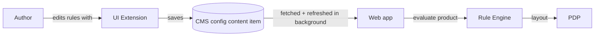
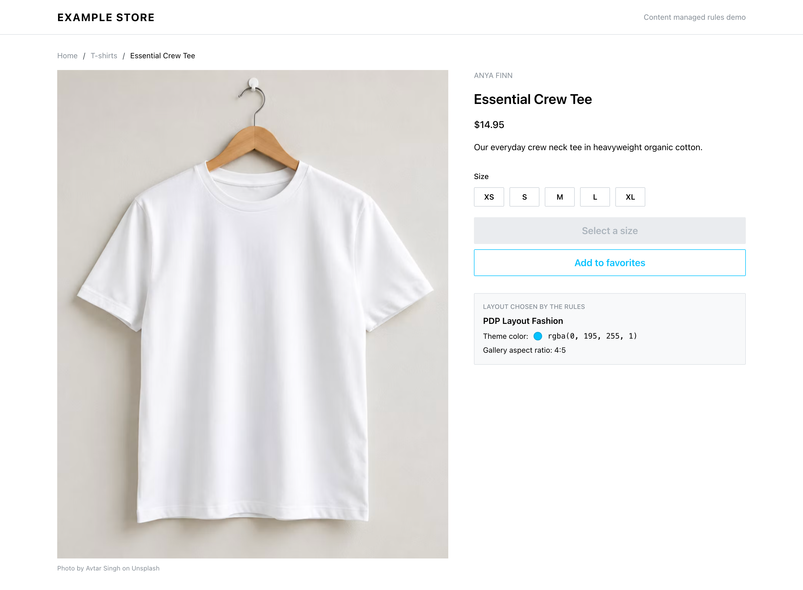
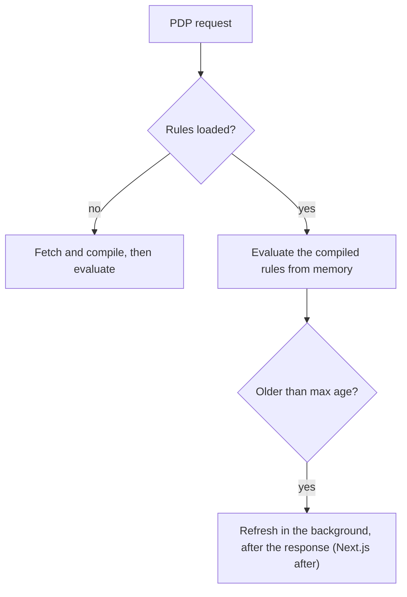
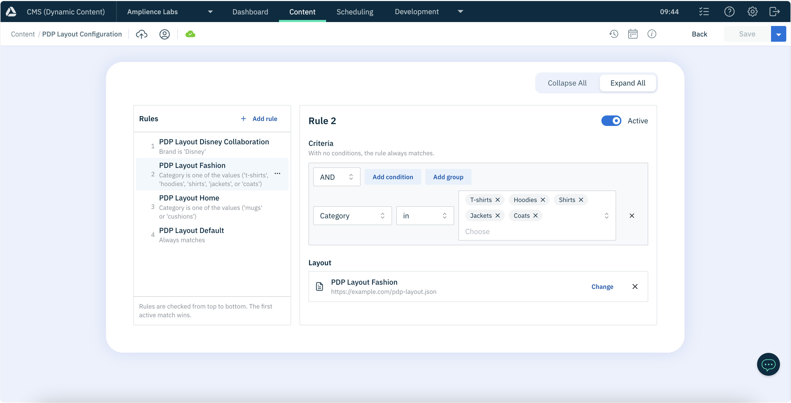
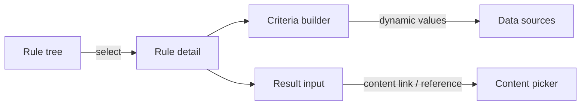

# Content Managed Rules Example

An example of letting content authors control application behaviour with rules managed in the CMS. The example use case is choosing which **product detail page (PDP) layout** to render for a product, based on criteria such as product category or brand.

## How it works

1. Authors maintain a content item that acts as **configuration**. It holds an ordered list of rules, and each rule pairs some **criteria** with a **result** (e.g. a layout).
2. The web application fetches the content item and keeps the compiled rules in memory, refreshing them in the background (stale-while-revalidate), so page requests never wait on fetching the rules.
3. For each request, the application evaluates the rules against the current context (e.g. the product). The first rule that matches decides the result.



## Repository layout

This repository is an npm workspace with two projects:

| Project                       | Path                           | Description                                                          |
| ----------------------------- | ------------------------------ | -------------------------------------------------------------------- |
| [Web](#web)                   | [web/](web/)                   | Next.js example store that loads and evaluates the rules.            |
| [UI Extension](#ui-extension) | [ui-extension/](ui-extension/) | React UI extension for the CMS, used by authors to manage the rules. |

The [example content types](#example-content-types) used by the web app are in [schemas/](schemas/).

## Getting started

Requires Node.js 26 (see [.nvmrc](.nvmrc)).

```bash
nvm use
npm install
cp web/.env.example web/.env.local
```

From the repository root:

| Command                    | Description                                 |
| -------------------------- | ------------------------------------------- |
| `npm run dev:web`          | Start the Next.js app in development mode.  |
| `npm run dev:ui-extension` | Start the UI extension in development mode. |
| `npm run storybook`        | Start Storybook for the UI extension.       |
| `npm run build`            | Build both projects.                        |
| `npm run lint`             | Lint both projects.                         |
| `npm test`                 | Run the unit tests for both projects.       |
| `npm run bench -w web`     | Run the web benchmarks.                     |

---

## Example content types

The web app reads its PDP layout rules from two Amplience content types. Their schemas are in [schemas/](schemas/):

| Content type             | Schema                                                                         | Description                                                                                                                          |
| ------------------------ | ------------------------------------------------------------------------------ | ------------------------------------------------------------------------------------------------------------------------------------ |
| PDP Layout               | [schemas/pdp-layout.json](schemas/pdp-layout.json)                             | How a PDP looks: a **Theme Color Override** for buttons and active states, and the photo gallery's **Aspect Ratio**.                 |
| PDP Layout Configuration | [schemas/pdp-layout-configuration.json](schemas/pdp-layout-configuration.json) | An ordered list of `rules`, edited with the [`rules-array` extension](#ui-extension). Each rule's result links to a PDP Layout item. |

The configuration's `fields` let authors write criteria on a product's category (from the `categories` [data source](#data-sources)), brand, price, whether it's on sale, and SKU (from the `products` data source).

To set them up in a hub:

1. Register the [UI extension](ui-extension/README.md#using-it-in-amplience) as `rules-array`.
2. Register both schemas and create content types from them.
3. Create some **PDP Layout** content items.
4. Create a **PDP Layout Configuration** content item with the delivery key `config/pdp-layout`, add rules that link to the layouts, and publish it.

---

## Web

A [Next.js](https://nextjs.org/) (App Router, TypeScript) application.

### Example store

An example store, built with [Mantine](https://mantine.dev/), whose product detail pages are laid out by the rules in the CMS.



```bash
npm run dev:web
```

| Page     | Source                                                   | Description                                                                           |
| -------- | -------------------------------------------------------- | ------------------------------------------------------------------------------------- |
| `/`      | [web/src/app/page.tsx](web/src/app/page.tsx)             | A product listing grid.                                                               |
| `/[sku]` | [web/src/app/[sku]/page.tsx](web/src/app/[sku]/page.tsx) | The PDP, e.g. `/SKU-1001`, styled by the PDP Layout the rules choose for the product. |

#### Configuration

The store fetches content with the [Amplience Content Delivery SDK](https://github.com/amplience/dc-delivery-sdk-js) (`dc-delivery-sdk-js`). Set these in `web/.env.local` (see [web/.env.example](web/.env.example)):

| Variable                           | Default | Description                                                        |
| ---------------------------------- | ------- | ------------------------------------------------------------------ |
| `AMPLIENCE_HUB_NAME`               | –       | Hub to fetch content from, e.g. `ampliencelabs`.                   |
| `PDP_LAYOUT_RULES_KEY`             | –       | Delivery key of the PDP Layout Configuration, `config/pdp-layout`. |
| `PDP_LAYOUT_RULES_MAX_AGE_SECONDS` | `60`    | How long the rules in memory are fresh before they're refreshed.   |

#### Products

The products are an in-memory catalogue in [web/src/lib/products/products.ts](web/src/lib/products/products.ts). Replace the catalogue with calls to your PIM.

The photos are from [Unsplash](https://unsplash.com/), credited under each image on the PDP.

#### Loading the rules

Source: [web/src/lib/pdp/pdp-layout.ts](web/src/lib/pdp/pdp-layout.ts), [web/src/lib/rules/swr-rule-engine.ts](web/src/lib/rules/swr-rule-engine.ts)

The PDP Layout Configuration is fetched by delivery key, with linked content inlined, so each rule's result is the PDP Layout itself. The rules are compiled into a [`RuleEngine`](#rule-engine) held in memory, one per server process, by `SwrRuleEngine`, which refreshes it with **stale-while-revalidate**:



- Only the first request waits for the rules. After that, requests are evaluated from memory, even while a refresh is running.
- Many stale requests start only one refresh.
- If a refresh fails, or the new rules don't compile, the previous rules stay in effect and the next attempt waits for another max age.
- If no rule matches, or the rules can't be loaded at all, the PDP uses a built-in fallback layout.

The rule context is built from the product, with the same variable names as the configuration's `fields`:

```json
{
  "product": {
    "sku": "SKU-2002",
    "brand": "ANYA FINN",
    "category": "hoodies",
    "price": 34.95,
    "onSale": true
  }
}
```

#### Applying the layout

The app uses [Cache Components](https://nextjs.org/docs/app/api-reference/config/next-config-js/cacheComponents). The product details on a PDP are prerendered, while the parts styled by the layout are rendered on each request inside `<Suspense>`, so a change to the rules shows without a rebuild:

- **Theme Color Override** is passed as the `color` of the size buttons, **Add to bag** and **Add to favorites**. Without one, the store's default is used.
- **Aspect Ratio** sets the shape of the photo gallery.
- A panel under the buttons shows which layout the rules chose, to make the demo easy to follow.

### Rule Engine

Source: [web/src/lib/rules/rule-engine.ts](web/src/lib/rules/rule-engine.ts)

`RuleEngine` evaluates an ordered list of rules against a context and returns the result of the first rule that matches.

It is built on [json-logic-engine](https://github.com/TotalTechGeek/json-logic-engine), an implementation of [JSON Logic](https://jsonlogic.com/). JSON Logic expresses conditions as plain JSON, so rules can be stored in a CMS content item, edited by authors, and evaluated safely without running arbitrary code. `json-logic-engine` can **compile** expressions into JavaScript functions, which makes repeated evaluation much faster than interpreting the JSON on every call.

#### Rules

Each rule is a `criteria` (a JSON Logic expression), a `result`, and an optional `active` flag:

```json
[
  {
    "criteria": { "==": [{ "var": "product.brand" }, "Disney"] },
    "result": "disney"
  },
  {
    "criteria": {
      "in": [{ "var": "product.category" }, ["t-shirts", "hoodies", "jackets"]]
    },
    "result": "apparel"
  },
  {
    "criteria": {
      "and": [
        { "==": [{ "var": "product.brand" }, "Nike"] },
        { "==": [{ "var": "product.category" }, "shoes"] }
      ]
    },
    "result": "footwear",
    "active": false
  },
  {
    "criteria": true,
    "result": "default"
  }
]
```

- `{ "var": "product.brand" }` reads a value from the context passed to `evaluate`.
- Rules are evaluated **in order**, so the array order is the priority. The first match wins.
- A rule with `"criteria": true` always matches, which makes it a useful catch-all default at the end of the list.
- Set `"active": false` to turn a rule off without deleting it. Rules are active by default when the flag is omitted. Inactive rules are skipped when the rules are loaded, so they are never compiled or evaluated.
- Common operators include `==`, `!=`, `in`, `and`, `or`, `!`, `<`, `>`. See the [JSON Logic operations](https://jsonlogic.com/operations.html) for the full list.

#### Usage

```ts
import { RuleEngine } from "@/lib/rules/rule-engine";

type Layout = "default" | "apparel" | "footwear" | "disney";

interface ProductContext {
  product: { category: string; brand: string };
}

const pdpLayouts = new RuleEngine<Layout, ProductContext>(rules);

pdpLayouts.evaluate({ product: { category: "hoodies", brand: "Disney" } }); // "disney"
pdpLayouts.evaluate({ product: { category: "hoodies", brand: "Acme" } }); // "apparel"
pdpLayouts.evaluate({ product: { category: "mugs", brand: "Acme" } }); // "default"

// When the CMS content item changes, load the new rules.
pdpLayouts.load(updatedRules);
```

- **Compiled once.** Rules are compiled when they are loaded, not when they are evaluated.
- **Safe reloads.** `load` compiles every rule before replacing the current set. If any rule is invalid it throws and the previously loaded rules stay in effect, so a bad update can't break live pages.
- **Multiple instances.** Each instance is independent, so you can create one per concern (PDP layout, badges, promotions, and so on).

#### Tests

Source: [web/src/lib/rules/rule-engine.test.ts](web/src/lib/rules/rule-engine.test.ts)

Covers category equals, category in a list, brand equals, combined criteria, priority order, inactive rules, reloading rules, keeping the existing rules on an invalid reload, and independent instances.

```bash
npm test -w web
```

#### Benchmarks

Source: [web/src/lib/rules/rule-engine.bench.ts](web/src/lib/rules/rule-engine.bench.ts)

The benchmark generates **500 rules** using a mix of equals, in-list and `and` criteria, and compares the compiled `RuleEngine` against interpreting the same rules with `json-logic-engine` without compilation.

| Scenario                                   | Compiled | Interpreted | Speed-up |
| ------------------------------------------ | -------- | ----------- | -------- |
| Load (compile) 500 rules                   | 1.29 ms  | –           | –        |
| Evaluate 500 rules, match on the last rule | 0.017 ms | 0.107 ms    | ~6x      |
| Evaluate 500 rules, no match               | 0.016 ms | 0.107 ms    | ~6.5x    |

Times are the average of 10 benchmark runs, each reporting a mean time, on an Apple M1 Max with Node.js 26. The match-on-last-rule and no-match scenarios are worst cases, because every rule is checked. In practice most requests match an earlier rule and return sooner.

Compilation only happens when rules are loaded, so its cost is paid once per content update rather than per request.

Run the benchmarks with:

```bash
npm run bench -w web
```

---

## UI Extension

A [React](https://react.dev/) + [Vite](https://vite.dev/) (TypeScript) application that runs inside Amplience as a content field UI extension, giving authors an editor for the rules in the configuration content item. It uses the [dc-extensions-sdk](https://github.com/amplience/dc-extensions-sdk) to talk to the CMS.



See [ui-extension/README.md](ui-extension/README.md) for how to run it, register it in Amplience, and extend it.



- **Rule tree** (left): lists the rules in evaluation order using the Mantine `Tree`. Select a rule to edit it, add rules, delete them, and reorder them by dragging or with **Move up** / **Move down**. Each row shows the result, a plain-language summary of the criteria, and whether the rule is inactive.
- **Rule detail** (right): an **Active** switch, a criteria builder, and an input for the result.
- **Criteria builder**: [React Query Builder](https://react-querybuilder.js.org/) with its [Mantine](https://mantine.dev/) controls. Queries are converted to and from JSON Logic, so the saved criteria are evaluated directly by the web [Rule Engine](#rule-engine). With no conditions, a rule saves `"criteria": true` and always matches.
- **Result input**: chosen from the JSON schema of the field.

The UI is built with Mantine, like the Amplience design system, with the Amplience colours and IBM Plex Sans font. It uses Mantine 9 for its `TreeSelect`, which hierarchical data sources need.

### Content type schema

The extension edits an array field. The schema of each rule's `result` (under `items.properties.result`) decides which input is shown. The criteria **variables** authors can choose from are set in the `fields` param of the extension:

```json
{
  "rules": {
    "title": "Rules",
    "type": "array",
    "items": {
      "type": "object",
      "properties": {
        "criteria": { "type": ["object", "boolean"] },
        "active": { "type": "boolean" },
        "result": {
          "title": "Layout",
          "allOf": [
            {
              "$ref": "http://bigcontent.io/cms/schema/v1/core#/definitions/content-link"
            },
            {
              "properties": {
                "contentType": {
                  "enum": ["https://example.com/pdp-layout.json"]
                }
              }
            }
          ]
        }
      }
    },
    "ui:extension": {
      "name": "rules-array",
      "params": {
        "fields": [
          {
            "name": "product.category",
            "label": "Category",
            "values": ["t-shirts", "hoodies", "shoes"]
          },
          { "name": "product.brand", "label": "Brand", "type": "string" },
          { "name": "product.price", "label": "Price", "type": "number" },
          { "name": "product.onSale", "label": "On sale", "type": "boolean" },
          {
            "name": "product.sku",
            "label": "Product",
            "dataSource": "products"
          }
        ]
      }
    }
  }
}
```

- `criteria` must allow `boolean` as well as `object`, because a rule with no conditions is saved as `true`.
- `fields` can also be set in the extension's installation params, to share them between content types. Instance params (in the schema) take priority.

#### Supported results

| Result schema                                  | Input                                                      |
| ---------------------------------------------- | ---------------------------------------------------------- |
| `"type": "string"`                             | Text box                                                   |
| `"type": "string"` with an `enum`              | Select                                                     |
| Content link (`content-link` `$ref`)           | Button that opens the content browser, then shows the item |
| Content reference (`content-reference` `$ref`) | As above                                                   |

Other result types show a message saying they aren't supported.

#### Criteria fields

Each entry in `fields` is a variable the rule engine reads from its context with `{ "var": name }`.

| Param        | Description                                                                               |
| ------------ | ----------------------------------------------------------------------------------------- |
| `name`       | Path in the context, e.g. `product.brand`.                                                |
| `label`      | Shown to authors. Defaults to `name`.                                                     |
| `type`       | `string` (default), `number` or `boolean`. Sets the operators and input.                  |
| `values`     | A fixed list of choices, as strings or `{ "value", "label" }` objects. Shown as a select. |
| `dataSource` | The id of a [data source](#data-sources) to choose values from, e.g. products from a PIM. |

Operators are limited to those standard JSON Logic supports: `=`, `!=`, `contains` and `in` / `not in` for text, `=`, `!=`, `in` and `not in` for choices, and comparisons for numbers.

### Data sources

Some values come from another system and are too many to list in a schema, such as products or categories in a PIM. A data source lets authors choose them instead. Data sources are registered in code, in [ui-extension/src/data-sources/dataSources.ts](ui-extension/src/data-sources/dataSources.ts), and come in two kinds.

A **search** data source is for long, flat lists. Authors type to search, in a select:

```ts
export interface SearchDataSource {
  type: "search";
  /** Find options matching what the author has typed. */
  search(query: string): Promise<DataSourceOption[]>;
  /** Resolve options for values already saved in a rule, so they show their labels. */
  getOptions(values: string[]): Promise<DataSourceOption[]>;
}
```

A **tree** data source is for hierarchies. It loads the whole tree once, shown in a tree select:

```ts
export interface TreeDataSource {
  type: "tree";
  getTree(): Promise<DataSourceTreeNode[]>;
}

export interface DataSourceTreeNode {
  value: string;
  label: string;
  children?: DataSourceTreeNode[];
}
```

Both included data sources are **mocks**. Replace them with calls to your PIM:

- `products` in [productDataSource.ts](ui-extension/src/data-sources/productDataSource.ts) is a search data source with a small catalogue.
- `categories` in [categoryDataSource.ts](ui-extension/src/data-sources/categoryDataSource.ts) is a tree data source, e.g. Clothing › Tops › T-shirts.

The saved criteria store option values (e.g. the SKU), so the web app's context must provide the same values. In a tree, only leaves are saved: with `=` or `!=` authors pick a single leaf, and with `in` or `not in` checking a parent selects every leaf beneath it. So a product's context should give its leaf category.

A short, fixed hierarchy doesn't need a data source. Compare a category field with the choices listed in the schema to one that uses the tree:

```json
{
  "name": "product.category",
  "label": "Category",
  "values": ["t-shirts", "hoodies", "shoes"]
}
```

```json
{ "name": "product.category", "label": "Category", "dataSource": "categories" }
```

### Content links and references

Choosing a content link or reference opens the Amplience content browser, filtered to the content types in the result schema. The extension shows the chosen item's name by fetching it from the Content Management API, so the extension's registration in Amplience needs **API permissions** for reading content. Without them it shows the item's id instead.

### Schema utilities

[ui-extension/src/schema/](ui-extension/src/schema/) holds small ports of Amplience utilities, used to read the result schema: `isContentRelationship`, `parseContentRelationshipSchema` and `inferSchemaType`.

### Storybook

The components have [Storybook](https://storybook.js.org/) stories with each supported result schema, the product and category data sources, categories as a fixed list, and read-only and empty states. Stories use mock services instead of the SDK, so the content picker cycles through sample items.

```bash
npm run storybook
```

### Tests

Unit tests cover converting criteria to and from JSON Logic, and reading result schemas.

```bash
npm test -w ui-extension
```

---

## License

[MIT](LICENSE)
